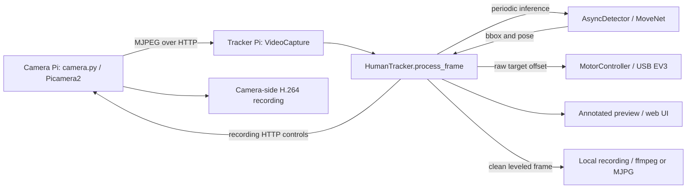

# piStreamTracker project map

Agent orientation, updated for the recording, recovery, geometry and setup fixes
on 2026-10-09 (base commit `1da684e`). This is a
navigation aid, not a specification. Source code and tests determine current
behavior; recheck the relevant section before changing it.

## System at a glance

A lecturer-following camera system: a Pi 3B+ captures video, a Pi 5 tracks one
person and controls an EV3 pan/tilt head. The tracker can run with an OpenCV
window or a Flask web UI. Persistent artifacts are files; there is no database.



See [README.md](README.md) for hardware, setup, controls, and configuration
examples. Existing root `.mmd` diagrams contain older class/method names;
use the source and this map for current ownership.

## Entry points and ownership

| Area | Start here | Responsibility |
|---|---|---|
| Camera service | [camera.py](camera.py) | Picamera2, threaded MJPEG HTTP server, camera H.264 recorder and `/record/*` API |
| Desktop/headless tracker | [tracker.py](tracker.py), [track.py](pistream/track.py) | CLI parsing, `HumanTracker`, `ObjectTracker`, rendering, screenshots, recording coordination |
| Web controls | [web.py](web.py), [web_app.py](pistream/web_app.py) | Flask routes, preview, runtime settings, recordings proxy, background tracker loop |
| Session lifetime | [lifecycle.py](pistream/lifecycle.py) | Serialized web start/stop, startup confirmation, cancellation, cleanup ownership |
| Capture | [capture.py](pistream/capture.py) | Latest-frame buffer, OpenCV backends, automatic stream reconnect |
| Detection | [detect.py](pistream/detect.py) | MoveNet model acquisition/interpreter, pose parsing, asynchronous inference |
| Motors | [motors.py](pistream/motors.py), [motors_math.py](pistream/motors_math.py), [ev3_usb.py](pistream/ev3_usb.py) | USB command serialization, deadzones, speed, home/manual holds; pure axis math; ev3-dc wrapper |
| Recording | [record.py](pistream/record.py), [recordings.py](pistream/recordings.py) | Timed local writer, encoder probing/fallback, file listing/path confinement, remote file operations |
| Preview geometry | [preview.py](pistream/preview.py), [horizon.py](pistream/horizon.py) | New-frame/rate gates, resize/FPS caps, pose roll estimation, smoothing, rotate/crop |
| HTTP helpers | [camera_auth.py](pistream/camera_auth.py), [stream_limit.py](pistream/stream_limit.py), [jsonutil.py](pistream/jsonutil.py) | Bearer token checks, camera stream slots, defensive JSON-object parsing |
| Configuration | [config.yaml](config.yaml), [config.py](pistream/config.py) | User settings, built-in defaults, validation, preset/CLI merge, host selection and logging |
| Installation | [setup.sh](setup.sh), [install.py](pistream/install.py) | apt/venv/pip bootstrap; planned network, systemd and udev operations |
| Launch wrappers | [run_cam.sh](run_cam.sh), [run_tracker.sh](run_tracker.sh) | Checkout working directory, venv selection, role/preset flags, active-service checks |
| Browser UI | [index.html](pistream/templates/index.html), [app.js](pistream/static/app.js), [style.css](pistream/static/style.css) | Jinja page, plain JavaScript controls/status polling, CSS; no frontend build step |
| Development source | [fake_mjpeg.py](scripts/fake_mjpeg.py) | Synthetic local MJPEG stream; text frames exercise plumbing, not human detection |

Root [ev3_usb.py](ev3_usb.py) is a compatibility shim. The implementation is in
the package. Packaging and dependency constraints live in [pyproject.toml](pyproject.toml).

## Tracking and concurrency

`HumanTracker.process_frame()` in `pistream/track.py` is the central pipeline:

1. Poll the latest asynchronous detection result.
2. Initialize/refresh the OpenCV box tracker when inactive or box IoU is below
   `REINIT_IOU` (currently 0.3). Tracker preference is MOSSE, then KCF, then CSRT.
3. Submit inference periodically, or urgently when there is no active target,
   while inference is idle.
4. Update the tracked box between pose detections.
5. Aim motors at horizontal box center and one-quarter box height.
6. Level the image, draw overlays, then apply digital preview zoom.

MoveNet returns one box and 17 `(x, y, confidence)` keypoints. It uses TFLite
Runtime, then LiteRT, then TensorFlow as import fallbacks. `poll_result()` distinguishes
a new negative result `(True, None)` from no new result `(False, None)`;
only new negatives count toward `DETECTION_MISS_LIMIT` (currently three).

- Capture continuously publishes one latest frame under a lock. Consumers use
  `accept_new_frame()` to skip repeated frame objects and failed reads.
- `AsyncDetector` copies submitted frames, uses single pending/result slots,
  and runs inference on a daemon worker. It does not queue every video frame.
- The web tracker loop is another worker. Flask shares one `TrackerLifecycle`
  and one annotated frame/sequence per process. Lifecycle retains a live
  startup worker after timeout, preventing overlapping sessions, and performs
  cleanup in the worker's `finally`. It retains the tracker after incomplete local
  writer closure or an unconfirmed camera stop, blocking replacement sessions.
  Concurrent Stop requests serialize; only explicit Stop retries pending work.
- Motor USB calls share an I/O lock; recording coordination uses an `RLock`.
  Local encoding and ffmpeg stderr draining have their own workers.

Motor commands are relative finite-degree moves. A replacement command stops
an existing move first. Home is the encoder position captured at connection.
Home/manual holds suppress automatic updates and ordinary `stop()`;
`disconnect()` stops directly.

## Preview, recording, and HTTP boundaries

| Output | Frame used |
|---|---|
| Motor aiming | Raw, unrotated bounding-box coordinates |
| Annotated preview / screenshot | Leveled, annotated, digitally zoomed frame |
| Local video | Clean full-resolution frame, optionally horizon-leveled, before overlays and zoom |
| Camera video | Original camera-side H.264, without tracker image transforms |
| Overlay-off preview | Raw camera MJPEG proxy when available, without tracker transforms; otherwise annotated preview |

Overlay preview is resized/rate-limited and JPEG-encoded per connected viewer.
Raw proxy viewers each use an additional camera stream connection. Horizon
correction estimates body roll from confident shoulder/hip pairs, canonicalizes
each vector toward increasing screen-x, smooths and clamps it, and holds the last
angle when the target is lost. The affine transform levels that signed screen angle.
CLI keyboard events run even for missing/repeated frames; processing, recording,
FPS and preview updates accept only new frames. Screenshots use the last displayed frame.

Camera-mode recording first calls `/record/start`. If its response fails,
the tracker checks `/record/status` before falling back locally. A failed
camera stop requires an explicit JSON `recording: false` confirmation. Cleanup
stops local tracking first and makes one camera-stop attempt; repeated cleanup
and status polls never retry. The web owner remains retained with a warning and
manual **Retry camera stop**. CLI recovery accepts R/Q in a window or `retry`/`quit`
on a headless terminal. Forced exit, EOF and noninteractive headless recovery
exit nonzero. OpenCV display failures fall back to terminal recovery when a TTY
is available. Recovery state is in memory only.

Local `auto` encoding probes
`h264_v4l2m2m`, then `libx264`, then uses OpenCV MJPG `.avi`. The local writer
repeats the latest frame to maintain its selected constant FPS. Writer errors,
worker completion and resource closure have separate state. Recording activity
reflects writer health; the first error remains visible until a successful restart.
Failed writers close before replacement. Output ownership lasts until resource
closure, independent of tracking/recording activity.

ffmpeg uses unbuffered stdin and completes partial writes. Stop gives the worker
two seconds; a blocked worker triggers encoder kill before stdin closure, followed
by bounded two-second process/worker waits. Normal encoder finalization has ten
seconds before kill. Incomplete closure retains ownership for explicit Stop retry;
an OpenCV writer is never released while its worker is writing.

- Camera: `/stream`; `/record/start`, `/record/stop`, `/record/status`,
  `/record/list`, and `/record/files/<filename>`.
- Tracker: `/`, `/video_feed`; `/api/status`, `/api/config`; start/stop/reset,
  record/screenshot, EV3/manual movement, zoom/settings, and recordings routes.
  Definitions are grouped in `pistream/web_app.py`.
  Status adds `recording_error`, `recording_stop_pending`, `stopping` and `warning`.
  Unconfirmed shutdown reports `running: false`, conservative `recording: true`.
  Start returns 409 while shutdown is unresolved; Stop returns 202 during cleanup,
  503 for unconfirmed camera stop and 200 after confirmation.
- Optional camera Bearer authentication covers `/record/*`, not `/stream`;
  an empty token leaves recording endpoints open. The tracker has same-origin
  browser mutation checks and security headers, but no login.
  Binding defaults to configured device IPs; this is a trusted-LAN control app.
- `safe_recording_path()` confines a single filename to the output directory.
  Both services reject deletion of active recordings. Remote downloads and
  deletes go through the tracker with `source=camera`.

## Configuration, files, and deployment

Configuration precedence is built-in defaults → recursively merged YAML →
named preset → explicit CLI flags. `PISTREAM_CAMERA_TOKEN` overrides the YAML
token. `load_config()` validates startup settings; a missing YAML file uses
built-in defaults. Most web settings mutate the current tracker only. Overlay
also changes in-memory web config; UI controls do not write `config.yaml`.

Paths to remember: camera `recording_dir`, tracker `output_dir`, optional log
file, and the downloaded `models/movenet_lightning.tflite`. Relative output,
config and log paths depend on the working directory; launch wrappers and
systemd use the checkout directory. The installer resolves the selected config to
an absolute path and quotes it in service arguments for both roles. Model lookup uses `project_root()`.
Recordings, model cache, logs and virtual environments are gitignored.

Deployment uses a source checkout and Python >=3.11. `setup.sh` bootstraps
role-specific dependencies and a system-site-packages venv. Camera libraries
come from apt. The installer prefers NetworkManager, sets Ethernet static IPs
with `ipv4.never-default`, and supports networkd fallback. Each device uses
`pitracker.service`: `camera.py` on the camera, `web.py` on the tracker, running
as a normal user. Tracker udev rules grant EV3 USB access.

Laptop setup uses `pip install -e ".[dev,desktop]"`. The optional extra selects
`ai-edge-litert>=2.3,<2.4`, or `tensorflow>=2.16,<2.17` on Intel macOS. The base Pi
TFLite Runtime dependency remains unchanged. Browser sidebar width uses a CSS
variable; the mobile breakpoint controls its one-column layout.

For inspection, read source or use unit tests. Importing `camera.py` requires
Picamera2 but does not configure the server or create recording directories.
`main()` parses `--config` before `configure_camera()` builds config-dependent
directories, stream limits and page content. Constructing
`HumanTracker` may create files, download the model and connect to EV3.

## Verification and test navigation

From the repository root with the existing development environment:

```bash
rtk proxy .venv/bin/python -m pytest -q
rtk proxy .venv/bin/ruff check pistream tests tracker.py web.py camera.py ev3_usb.py
```

If the environment is `venv/`, substitute that path. Dependency setup and
manual/laptop launch instructions are in `README.md`. Read-only installer
status can use `rtk proxy .venv/bin/python -m pistream.install status`.

| Change area | Relevant tests |
|---|---|
| Config/presets/validation | [test_config.py](tests/test_config.py) |
| Reconnect and frame identity | [test_capture_policy.py](tests/test_capture_policy.py), [test_frame_gate.py](tests/test_frame_gate.py) |
| Async result semantics and tracker refresh/loss | [test_async_detector.py](tests/test_async_detector.py), [test_track_box.py](tests/test_track_box.py) |
| Motor commands and holds | [test_motors.py](tests/test_motors.py) |
| Web session startup/stop/timeout/recovery | [test_lifecycle.py](tests/test_lifecycle.py), [test_web_routes.py](tests/test_web_routes.py) |
| Leveling, preview geometry and rate caps | [test_horizon.py](tests/test_horizon.py), [test_preview.py](tests/test_preview.py) |
| Writer health, bounded encoder shutdown and ownership | [test_record_writer.py](tests/test_record_writer.py), [test_recording_backend.py](tests/test_recording_backend.py) |
| CLI controls and camera recovery | [test_tracker_cli.py](tests/test_tracker_cli.py), [test_recording_integration.py](tests/test_recording_integration.py) |
| Interpreter fallback | [test_detector_runtime.py](tests/test_detector_runtime.py) |
| Artifact paths and remote files | [test_recordings.py](tests/test_recordings.py), [test_web_routes.py](tests/test_web_routes.py) |
| Camera API/auth/client slots | [test_camera_server.py](tests/test_camera_server.py), [test_camera_auth.py](tests/test_camera_auth.py), [test_stream_limit.py](tests/test_stream_limit.py) |
| UI/package layout and API errors/validation | [test_package.py](tests/test_package.py), [test_web_routes.py](tests/test_web_routes.py) |
| Network/service/udev planning | [test_install.py](tests/test_install.py) |
| Mocked browser recovery and mobile layout | [browser_ui.cjs](tests/browser_ui.cjs), [web_ui_fixture.py](tests/web_ui_fixture.py) |

Baseline on 2026-10-09: 172 tests passed; Ruff passed on Python 3.12.12.
After these fixes, a fresh Python 3.12 desktop environment passed 228 tests and
25 subtests; Ruff and Chromium checks at 390/900/1200px also passed.
[CI](.github/workflows/ci.yml) runs Ubuntu with Python 3.11/3.12, installing
the declared `.[dev,desktop]` dependencies.
Tests use mocked hardware and Flask's test client; they do not establish real
Pi camera/EV3 behavior or MoveNet inference quality. Standalone browser checks
cover mocked recovery and responsiveness. A fresh macOS ARM desktop install was
smoke-tested with LiteRT 2.3 and the cached MoveNet model (finite `(1,1,17,3)` output).

## Observed caveats to recheck when working nearby

These are code observations at the revision above, not fixes made by this map.

- **Detection/reset:** results have no frame age or reset generation. An older
  result can initialize a tracker on a newer frame, including after reset.
  Keypoints retain their inference coordinates while the tracked box moves.
  See `AsyncDetector`, `process_frame()` and `reset_tracking()`.
- **Startup:** model acquisition happens during `HumanTracker` construction.
  Download timeouts can exceed the web lifecycle's default startup deadline.
  See `PoseDetector._get_model()` and `TrackerLifecycle.start()`.
- **Reconnect:** capture metadata and detector/motor dimensions are initialized
  at connection and not refreshed after reconnect. Resolution changes need
  explicit handling. See `VideoCapture.start()` and `_capture_loop()`.
- **Raw preview URL:** `camera_stream_url()` builds from camera IP/port and
  does not use the tracker's custom `stream_url`. See `preview.py` and
  `web_app._proxy_camera_stream()`.
- **Native OpenCV finalization:** worker writes are guarded, but OpenCV's native
  `VideoWriter.release()` call has no timeout. The ffmpeg subprocess shutdown
  bounds do not guarantee a bound on native MJPG file finalization.
- **Installer inspection:** `setup.sh status/network/service/udev` performs
  bootstrap steps before dispatch. Its `--dry-run` can still create a venv.
  Use the Python installer's status command for read-only status.
