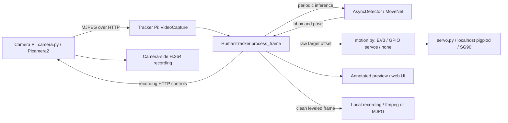

# piStreamTracker project map

Agent orientation, updated for the supplied Pi 4 camera configuration and delayed
tracking startup on 2026-10-28, following the recording/recovery fixes in October. This is a
navigation aid, not a specification. Source code and tests determine current
behavior; recheck the relevant section before changing it.

## System at a glance

A lecturer-following camera system with two deployment choices: Pi 3B+ with an
IMX219 camera and Pi 5 tracker with USB EV3, or one Pi 4 with an IMX219 camera
and two GPIO SG90 servos. The Pi 3B+ uses standard automatic sensor tuning via
`camera.tuning_file: null` in `config.yaml`. The supplied Pi 4 profile targets
an IMX219 with a 160-degree lens and custom tuning without ALSC. Automatic
sensor tuning also remains available for OV5647 and other cameras.
In standalone, `camera.py` alone opens CSI and `web.py` consumes its local MJPEG
at `127.0.0.1:8000`; the Flask UI binds to the LAN. Tracking can also run with an
OpenCV window or without motors. Persistent artifacts are files; no database.



See [README.md](README.md) for hardware, setup, controls, and configuration
examples. Existing root `.mmd` diagrams contain older class/method names;
use the source and this map for current ownership.

## Entry points and ownership

| Area | Start here | Responsibility |
|---|---|---|
| Camera service | [camera.py](camera.py) | Picamera2 and optional sensor tuning, threaded MJPEG HTTP server, camera H.264 recorder and `/record/*` API |
| Pi 4 camera profile | [imx219-160-no-alsc.json](tuning/imx219-160-no-alsc.json) | Supplied IMX219 tuning without `rpi.alsc`; selected only by `camera.tuning_file` |
| Desktop/headless tracker | [tracker.py](tracker.py), [track.py](pistream/track.py) | CLI parsing, `HumanTracker`, `ObjectTracker`, rendering, screenshots, recording coordination |
| Web controls | [web.py](web.py), [web_app.py](pistream/web_app.py) | Flask routes, preview, runtime settings, recordings proxy, background tracker loop |
| Session lifetime | [lifecycle.py](pistream/lifecycle.py) | Serialized web start/stop, delayed automatic start, startup confirmation, cancellation, cleanup ownership |
| Capture | [capture.py](pistream/capture.py) | Latest-frame buffer, OpenCV backends, automatic stream reconnect |
| Detection | [detect.py](pistream/detect.py) | MoveNet model acquisition/interpreter, pose parsing, asynchronous inference |
| Motors | [motors.py](pistream/motors.py), [motors_math.py](pistream/motors_math.py), [ev3_usb.py](pistream/ev3_usb.py) | USB command serialization, deadzones, speed, home/manual holds; pure axis math; ev3-dc wrapper |
| Controller selection | [motion.py](pistream/motion.py), [servo.py](pistream/servo.py) | Pan/tilt protocol and factory, no-motor backend, local pigpio position commands and frame watchdog |
| SG90 commissioning | [calibrate.py](pistream/calibrate.py), [config.pi4.yaml](config.pi4.yaml) | Interactive manual/Home tests, independent pulse calibration and mechanical limits, atomic YAML save and calibration gate |
| Recording | [record.py](pistream/record.py), [recordings.py](pistream/recordings.py) | Timed local writer, encoder probing/fallback, file listing/path confinement, remote file operations |
| Preview geometry | [preview.py](pistream/preview.py), [horizon.py](pistream/horizon.py) | New-frame/rate gates, resize/FPS caps, pose roll estimation, smoothing, rotate/crop |
| HTTP helpers | [camera_auth.py](pistream/camera_auth.py), [jsonutil.py](pistream/jsonutil.py) | Bearer token checks, defensive JSON-object parsing; camera stream slots use `threading.BoundedSemaphore` in `camera.py` |
| Configuration | [config.yaml](config.yaml), [config.py](pistream/config.py) | User settings, built-in defaults, validation, preset/CLI merge, host selection and logging |
| Installation | [setup.sh](setup.sh), [install.py](pistream/install.py) | apt/venv/pip bootstrap; planned network, systemd and udev operations |
| Launch wrappers | [run_cam.sh](run_cam.sh), [run_tracker.sh](run_tracker.sh), [run_standalone.sh](run_standalone.sh) | Checkout working directory, venv selection, active-service checks; standalone child ownership/signal cleanup |
| Browser UI | [index.html](pistream/templates/index.html), [app.js](pistream/static/app.js), [style.css](pistream/static/style.css) | Jinja page, plain JavaScript controls/status polling, CSS; no frontend build step |
| Development source | [fake_mjpeg.py](scripts/fake_mjpeg.py) | Synthetic local MJPEG stream; text frames exercise plumbing, not human detection |

Root [ev3_usb.py](ev3_usb.py) is a compatibility shim. The implementation is in
the package and covers finite-degree motors, encoder positions and LED status.
Packaging and dependency constraints live in [pyproject.toml](pyproject.toml);
[requirements.txt](requirements.txt) delegates to it with `-e .` (run pip from the checkout).

## Tracking and concurrency

`HumanTracker.process_frame()` in `pistream/track.py` is the central pipeline:

1. Poll the latest asynchronous detection result.
2. Initialize/refresh the OpenCV box tracker when inactive or box IoU is below
   `REINIT_IOU` (currently 0.3). Tracker preference is MOSSE, then KCF, then CSRT.
3. Submit inference periodically, or urgently when there is no active target,
   while inference is idle.
4. Update the tracked box between pose detections.
5. Aim motors at horizontal box center and one-quarter box height.
6. Level the image, draw overlays, then apply digital preview zoom.

MoveNet returns one box and 17 `(x, y, confidence)` keypoints. It uses TFLite
Runtime, then LiteRT, then TensorFlow as import fallbacks. `poll_result()` distinguishes
a new negative result `(True, None)` from no new result `(False, None)`;
only new negatives count toward `DETECTION_MISS_LIMIT` (currently three).

- Capture continuously publishes one latest frame under a lock. Consumers use
  `read_sample()` / `HumanTracker.read_frame()` to keep its monotonic timestamp
  and reconnect generation with the consumed frame. `accept_new_frame()` skips
  repeated frame objects and failed reads.
- `AsyncDetector` copies submitted frames, uses single pending/result slots,
  and runs inference on a daemon worker. It rejects old results using submission
  age (`tracker.detection.result_timeout`) and invalidates pending/inflight work
  on Reset, reconnect, frame gaps and stop. Resize buffers follow actual frames.
- The web tracker loop is another worker. Flask shares one `TrackerLifecycle`
  and one annotated frame/sequence per process. Lifecycle retains a live
  startup worker after timeout, preventing overlapping sessions, and performs
  cleanup in the worker's `finally`. It retains the tracker after incomplete local
  writer closure, unfinished capture/detection workers or an unconfirmed camera
  stop, blocking replacement sessions.
  Concurrent Stop requests serialize; only explicit Stop retries pending work.
  Each web process schedules one automatic start after `web.autostart_delay`
  seconds (120 by default, null disables). Manual Start/Stop cancels the pending
  start; process shutdown cancels it before cleanup. Automatic startup uses the
  same lifecycle and configured motor backend as manual Start, retaining motor
  disable flags and the SG90 calibration gate, and does not start recording.
- Motor USB calls share an I/O lock; recording coordination uses an `RLock`.
  Local encoding and ffmpeg stderr draining have their own workers.

EV3 motor commands are relative finite-degree moves. A replacement command stops
an existing move first. Home is the encoder position captured at connection.
Home/manual holds suppress automatic updates and ordinary `stop()`;
`disconnect()` stops directly.

`motors.backend` selects `ev3`, `gpio_servo` or `none`; null preserves the old
`ev3.enabled` selection. `--no-motors` wins over all backend flags; `--no-ev3`
disables only a resolved EV3 backend. GPIO mode never opens EV3 USB. SG90 uses
BCM18/pan and BCM19/tilt by default, with one worker and host GPIO file locks.
All commands clamp working angles, map through independent calibration bounds
and clamp pulse widths. The worker limits degrees/second with monotonic time and
`max_dt`, holds the last issued command on target loss, and cancels automatic
movement after `frame_timeout` even without frame processing. Manual/Home hold
auto while moving and for the configured pause; Stop disconnects regardless of
holds. `calibrated: false` blocks auto but permits commissioning commands.
The current `config.pi4.yaml` preserves the supplied Pi's confirmed calibration,
pan ±90° / 500°/s and tilt ±45° / 300°/s. Built-in servo defaults remain
uncalibrated with conservative working ranges/speeds for commissioning.
Status distinguishes target and last commanded degrees; SG90 has no feedback.
Failed PWM-off is an error with unknown pulse state, retained in web status after
Stop; use the recovery instructions in README before reconnecting.

`request_stop()` disconnects motors before waiting for frame processing or
detector/capture teardown. GPIO reconnect requests serialize with stop/cleanup
through a separate control lock, so a stale HTTP request cannot reopen hardware.
SIGTERM cleanup is installed in camera, web, tracker CLI and calibration entry
points; the camera closes its listener, encoders and CSI device on partial startup
failure as well as normal exit.

## Preview, recording, and HTTP boundaries

| Output | Frame used |
|---|---|
| Motor aiming | Raw, unrotated bounding-box coordinates |
| Annotated preview / screenshot | Leveled, annotated, digitally zoomed frame |
| Local video | Clean full-resolution frame, optionally horizon-leveled, before overlays and zoom |
| Camera video | Original camera-side H.264, without tracker image transforms |
| Overlay-off preview | Raw camera MJPEG proxy when available, without tracker transforms; otherwise annotated preview |

Overlay preview is resized/rate-limited and JPEG-encoded per connected viewer.
Raw proxy viewers each use an additional camera stream connection. Horizon
correction estimates body roll from confident shoulder/hip pairs, canonicalizes
each vector toward increasing screen-x, smooths and clamps it, and holds the last
angle when the target is lost. The affine transform levels that signed screen angle.
CLI keyboard events run even for missing/repeated frames; processing, recording,
FPS and preview updates accept only new frames. Screenshots use the last displayed frame.

Camera-mode recording first calls `/record/start`. If its response fails,
the tracker checks `/record/status` before falling back locally. A failed
camera stop requires an explicit JSON `recording: false` confirmation. Cleanup
stops local tracking first and makes one camera-stop attempt; repeated cleanup
and status polls never retry. The web owner remains retained with a warning and
manual **Retry camera stop**. CLI recovery accepts R/Q in a window or `retry`/`quit`
on a headless terminal. Forced exit, EOF and noninteractive headless recovery
exit nonzero. OpenCV display failures fall back to terminal recovery when a TTY
is available. Recovery state is in memory only.

Local `auto` encoding probes
`h264_v4l2m2m`, then `libx264`, then uses OpenCV MJPG `.avi`. The local writer
repeats the latest frame to maintain its selected constant FPS. Writer errors,
worker completion and resource closure have separate state. Recording activity
reflects writer health; the first error remains visible until a successful restart.
Failed writers close before replacement. Output ownership lasts until resource
closure, independent of tracking/recording activity.

ffmpeg uses unbuffered stdin and completes partial writes. Stop gives the worker
two seconds; a blocked worker triggers encoder kill before stdin closure, followed
by bounded two-second process/worker waits. Normal encoder finalization has ten
seconds before kill. Incomplete closure retains ownership for explicit Stop retry;
an OpenCV writer is never released while its worker is writing.

- Camera: `/stream`; `/record/start`, `/record/stop`, `/record/status`,
  `/record/list`, and `/record/files/<filename>`.
  The server extends `http.server.ThreadingHTTPServer`; stream slots are acquired
  without blocking and released when each client disconnects.
- Tracker: `/`, `/video_feed`; `/api/status`, `/api/config`; start/stop/reset,
  record/screenshot, `/api/motors` connection toggle, manual movement, zoom/settings,
  and recordings routes. `/api/ev3` remains specific to the EV3 backend.
  Definitions are grouped in `pistream/web_app.py`.
  Status adds `recording_error`, `recording_stop_pending`, `stopping` and `warning`.
  `motors` includes backend, connection/error and SG90 calibration, command/target
  angles and working limits. EV3 speed/deadzone settings are backend-specific.
  Unconfirmed shutdown reports `running: false`, conservative `recording: true`.
  Start returns 409 while shutdown is unresolved; Stop returns 202 during cleanup,
  503 for unconfirmed camera stop and 200 after confirmation.
- Optional camera Bearer authentication covers `/record/*`, not `/stream`;
  an empty token leaves recording endpoints open. The tracker has same-origin
  browser mutation checks and security headers, but no login.
  Binding defaults to configured device IPs; this is a trusted-LAN control app.
- `safe_recording_path()` confines a single filename to the output directory.
  Both services reject deletion of active recordings. Remote downloads and
  deletes go through the tracker with `source=camera`.

## Configuration, files, and deployment

Configuration precedence is built-in defaults → recursively merged YAML →
named preset → explicit CLI flags. `PISTREAM_CAMERA_TOKEN` overrides the YAML
token. `load_config()` validates startup settings; a missing YAML file uses
built-in defaults. Most web settings mutate the current tracker only. Overlay
also changes in-memory web config; UI controls do not write `config.yaml`.
Web mode is selected by `web.py` or `run_tracker.sh --web`; the unused
`web.enabled` default and YAML entry have been removed.
`web.autostart_delay` defaults to 120 seconds even for existing YAML files that
omit it. Null disables the one-time automatic start; finite numeric values from
0 to 86400 select another delay. The web UI remains available during the wait.
`config.pi4.yaml` preserves the supplied Pi's localhost camera endpoints,
camera-side H.264 recording, separate `camera-recordings/` and tracker `recordings/`
directories, 1280×720 at 45 camera/recording FPS, JPEG quality 80, 2 inference
threads and 10 preview FPS. These are configured values, not measured throughput.
Its `camera.tuning_file` selects the bundled IMX219 160-degree profile without
`rpi.alsc`. The two-Pi `config.yaml` uses null for standard IMX219 tuning on
the Pi 3B+; built-in configuration defaults also leave sensor tuning to Picamera2.
Relative tuning paths resolve from the directory containing `camera.py`,
not the working directory or YAML directory; absolute paths are supported.
An explicitly selected profile must load successfully before camera acquisition;
there is no silent fallback to a different profile.
The built-in `pi4` performance preset remains 640×480 at 15 camera FPS and
overrides file settings when explicitly selected. Standalone services and the
standalone wrapper share the config without a preset, preserving its camera values.
`camera_stream_url()` and `camera_base_url()` in `preview.py` share camera addressing
for tracking, raw preview, recorder control and file operations. An explicit
HTTP(S) tracker stream URL supplies the control/file origin too.

Paths to remember: camera `recording_dir`, tracker `output_dir`, optional log
file, and the downloaded `models/movenet_lightning.tflite`. Relative output,
config and log paths depend on the working directory; tuning paths are the exception
described above. Launch wrappers and
systemd use the checkout directory. The installer resolves the selected config to
an absolute path and quotes it in service arguments for both roles. Model lookup uses `project_root()`.
Recordings, model cache, logs and virtual environments are gitignored.

Deployment uses a source checkout and Python >=3.11. `setup.sh` bootstraps
role-specific dependencies and a system-site-packages venv. Camera libraries
come from apt. The installer prefers NetworkManager, sets Ethernet static IPs
with `ipv4.never-default` and explicitly enables profile autoconnect, and supports
networkd fallback. Existing installs can save or repair the Ethernet settings with
`./run_cam.sh --configure-network` or `./run_tracker.sh --configure-network`;
manual `ip address` / `ip link` changes do not persist across reboots. Each device uses
`pitracker.service`: `camera.py` on the camera, `web.py` on the tracker, running
as a normal user. Tracker udev rules grant EV3 USB access.

Standalone skips network and EV3 udev changes. `setup.sh --standalone --config ...`
installs the union of camera/tracker dependencies and pigpio, preloads MoveNet,
and writes `pistream-camera.service`, `pistream-tracker.service`, plus a localhost-only
`pigpiod.service`. Tracker Requires/After camera and pigpiod; both applications get
the same absolute config and an ordinary user with video/render groups. An existing
legacy `pitracker.service` is disabled/stopped to avoid a second camera owner.
Pi 4 auto-selects standalone. `run_standalone.sh` owns two subprocesses with a
checkout lock, service guards and bounded signal/child-failure cleanup. Reboots
restore the three services; tracking and configured motor connection start
automatically after the web process's delay unless manual Start/Stop cancels it.

Laptop setup uses `pip install -e ".[dev,desktop]"`. The optional extra selects
`ai-edge-litert>=2.3,<2.4`, or `tensorflow>=2.16,<2.17` on Intel macOS. The base Pi
TFLite Runtime is pinned to 2.14.0 (Bookworm Python 3.11 ARM wheels), NumPy stays
below 2 and OpenCV below 4.10. Picamera2/libcamera come from apt and are visible via
`--system-site-packages`; standalone setup checks imports before enabling services.
Browser sidebar width uses a CSS
variable; the mobile breakpoint controls its one-column layout.

For inspection, read source or use unit tests. Importing `camera.py` requires
Picamera2 but does not configure the server or create recording directories.
`main()` parses `--config` before `configure_camera()` builds config-dependent
directories, stream limits and page content. Constructing
`HumanTracker` may create files, download the model and connect the selected controller.
`setup.sh status` and planning via `--dry-run` do not bootstrap apt/pip or create a venv.

## Verification and test navigation

From the repository root with the existing development environment:

```bash
rtk proxy .venv/bin/python -m pytest -q
rtk proxy .venv/bin/ruff check pistream tests tracker.py web.py camera.py ev3_usb.py
```

If the environment is `venv/`, substitute that path. Dependency setup and
manual/laptop launch instructions are in `README.md`. Read-only installer
status can use `rtk proxy .venv/bin/python -m pistream.install status`.

| Change area | Relevant tests |
|---|---|
| Config/presets/validation and automatic-start delay | [test_config.py](tests/test_config.py) |
| Reconnect and frame identity | [test_capture_policy.py](tests/test_capture_policy.py), [test_frame_gate.py](tests/test_frame_gate.py) |
| Async result semantics and tracker refresh/loss | [test_async_detector.py](tests/test_async_detector.py), [test_track_box.py](tests/test_track_box.py) |
| Motor commands and holds | [test_motors.py](tests/test_motors.py) |
| SG90 mapping, speed, holds/watchdog, ownership/errors and calibration | [test_servo.py](tests/test_servo.py), [test_calibrate.py](tests/test_calibrate.py) |
| Controller selection, local URLs, stop and stale-work boundaries | [test_motion_integration.py](tests/test_motion_integration.py), [test_motion_safety_review.py](tests/test_motion_safety_review.py) |
| Web session automatic/manual startup/stop/timeout/recovery | [test_lifecycle.py](tests/test_lifecycle.py), [test_web_routes.py](tests/test_web_routes.py) |
| Leveling, preview geometry and rate caps | [test_horizon.py](tests/test_horizon.py), [test_preview.py](tests/test_preview.py) |
| Writer health, bounded encoder shutdown and ownership | [test_record_writer.py](tests/test_record_writer.py), [test_recording_backend.py](tests/test_recording_backend.py) |
| CLI controls and camera recovery | [test_tracker_cli.py](tests/test_tracker_cli.py), [test_recording_integration.py](tests/test_recording_integration.py) |
| Interpreter fallback | [test_detector_runtime.py](tests/test_detector_runtime.py) |
| Artifact paths and remote files | [test_recordings.py](tests/test_recordings.py), [test_web_routes.py](tests/test_web_routes.py) |
| Camera tuning/startup/API/auth/client slots | [test_camera_server.py](tests/test_camera_server.py), [test_camera_auth.py](tests/test_camera_auth.py), [test_config.py](tests/test_config.py) |
| UI/package layout and API errors/validation | [test_package.py](tests/test_package.py), [test_web_routes.py](tests/test_web_routes.py) |
| Network/service/udev planning | [test_install.py](tests/test_install.py) |
| Standalone wrapper signals, services, children and setup dispatch | [test_standalone_launch.py](tests/test_standalone_launch.py) |
| Mocked browser recovery and mobile layout | [browser_ui.cjs](tests/browser_ui.cjs), [web_ui_fixture.py](tests/web_ui_fixture.py) |

Baseline on 2026-10-09: 172 tests passed; Ruff passed on Python 3.12.12.
After these fixes, a fresh Python 3.12 desktop environment passed 231 tests and
25 subtests; Ruff and Chromium checks at 390/900/1200px also passed.
Standalone validation on 2026-10-25 uses Python 3.12.12 on the development Mac:
314 tests and 35 subtests, Ruff, shell syntax and Chromium at 390/900/1200px.
The supplied Pi configuration and delayed-start integration were reconciled on
2026-10-28: 338 tests and 57 subtests passed, plus Ruff and an accelerated real-timer
smoke with mocked hardware. All prior Pi YAML values and tuning bytes were preserved.
A synthetic localhost MJPEG smoke exercised real OpenCV capture, web Start/Stop,
preview, screenshot and a readable local MJPG recording with detector/motors
disabled. Bookworm/Python 3.11 ARM wheel availability was checked against primary
package sources; installation and operation on Pi hardware remain unverified.
[CI](.github/workflows/ci.yml) runs Ubuntu with Python 3.11/3.12, installing
the declared `.[dev,desktop]` dependencies.
Tests use mocked hardware and Flask's test client; they do not establish real
Pi camera/EV3 behavior or MoveNet inference quality. Standalone browser checks
cover mocked recovery, GPIO controls and responsiveness. A fresh macOS ARM desktop install was
smoke-tested with LiteRT 2.3 and the cached MoveNet model (finite `(1,1,17,3)` output).

## Observed caveats to recheck when working nearby

These are code observations at the revision above, not fixes made by this map.

- **Pose overlays:** keypoints retain inference coordinates while the tracked
  box moves; result age/generation are now checked, but poses are not reprojected
  by the OpenCV box tracker.
- **Startup:** model acquisition happens during `HumanTracker` construction.
  Download timeouts can exceed the web lifecycle's default startup deadline.
  See `PoseDetector._get_model()` and `TrackerLifecycle.start()`.
- **Reconnect/recording:** capture/detector/motor dimensions follow new frames,
  but an already-open local recorder retains its initial geometry. Keep camera
  resolution fixed during a recording.
- **Native OpenCV finalization:** worker writes are guarded, but OpenCV's native
  `VideoWriter.release()` call has no timeout. The ffmpeg subprocess shutdown
  bounds do not guarantee a bound on native MJPG file finalization.
- **Hardware verification:** no Pi 4, CSI camera, SG90, real pigpiod or timing benchmark
  is available in the development environment. Follow README's hardware acceptance
  checklist; initial position commands cannot limit physical motion from an unknown
  startup position. Commission with unloaded horns and safe cable clearance.
